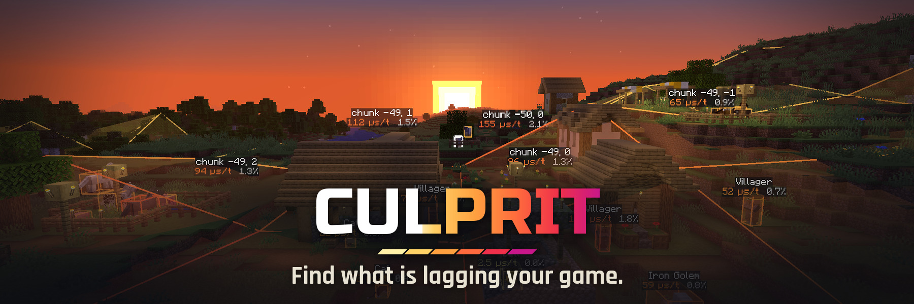
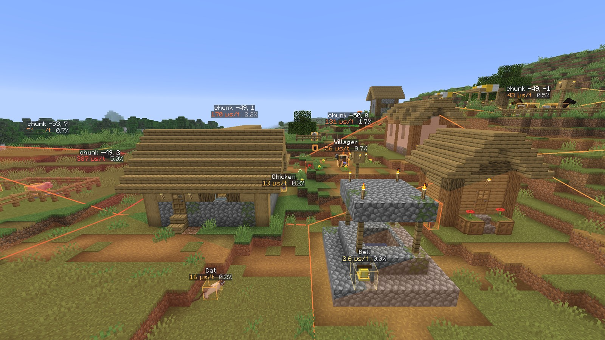
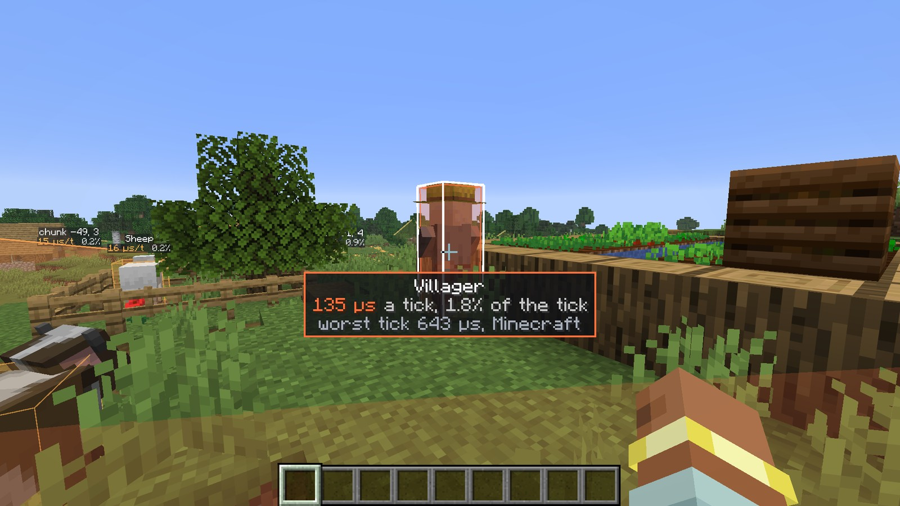
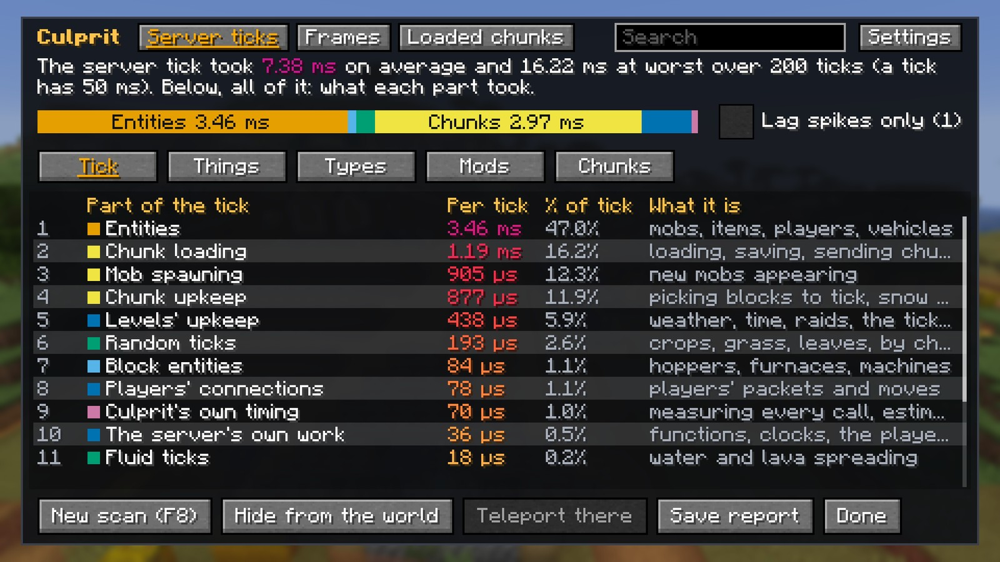
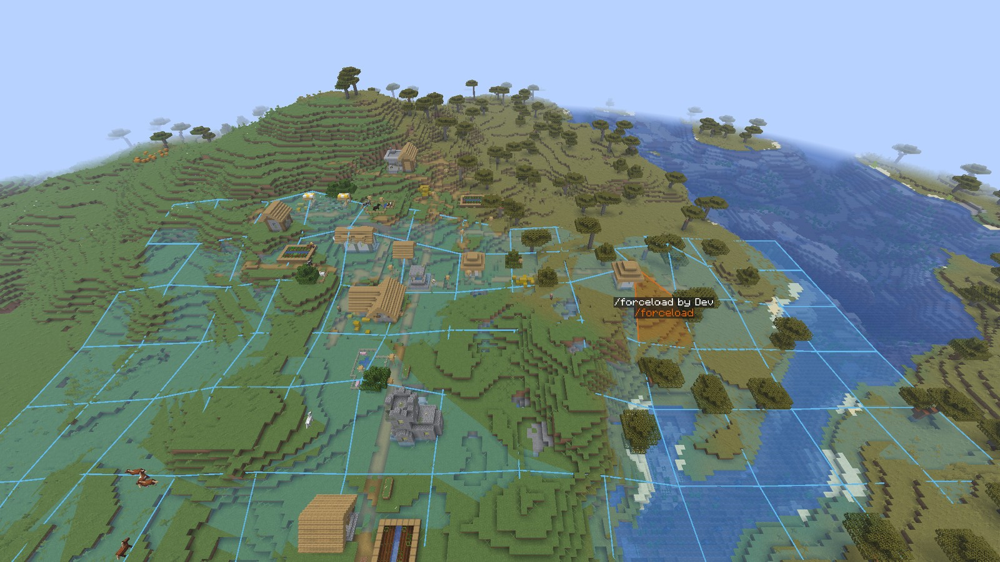

<p align="center">
  
</p>

<p align="center">
  A Minecraft mod for NeoForge 26.3, 26.1.2 and 1.21.1, and Forge 1.20.1
</p>

Scan your server for a few seconds and see, on the world itself, what every villager, hopper, furnace and farm costs it
each tick. Do the same for your frame rate, and see what keeps every chunk loaded and who asked for it. Culprit points
at the thing to blame, where it stands, and names the mod it comes from. It adds no items and no blocks.

## What's in it

- **Tick scan** (F8): every block entity and entity tick, scheduled block and fluid ticks, block events, random ticks by
  kind of block, each chunk's upkeep and mob spawning, and the rest of the server tick in parts, adding up to the tick.
- **Frame scan**: what each entity, block entity and kind of particle costs to draw, and every part of the frame, shader
  shadows and Distant Horizons' far terrain on their own. It needs nothing from the server.
- **Chunk inspector**: every loaded chunk and why it is loaded (players, /forceload and who ran it, portals, ender
  pearls, the spawn, other mods' chunk loaders with the block, player or team behind them), on a map and on the world.
- **On the world**: boxes coloured by cost from pale yellow to deep magenta, labels on the costliest close things, each
  chunk's total, the thing under your crosshair read out, a beam over the thing you picked.
- **The results screen** (F9): Tick, Things, Types, Mods and Chunks, for server ticks and for frames; search; lag
  spikes and stutters beside the averages; reports to share (Markdown and JSON); teleport for operators.
- **A HUD line** (off by default): the server's ticks a second and time a tick, and your frames a second.
- **Commands**: `/culprit scan [seconds]`, `stop`, `top [things|types|mods|chunks] [count]`, `chunks` and `export`.

While no scan runs, Culprit only checks a switch at each of the game's calls it watches; while one runs, it times its
own measuring and shows it as a part of the tick of its own.

## Screenshots

<p align="center">
  
  
</p>
<p align="center">
  
  
</p>

## Settings

In game: **Settings** in the results screen (F9), or **Mods**, **Culprit**, **Config**. In the files:
`config/culprit-client.toml` for your own (how far things are boxed, how many are labelled, when the results hide
themselves, the HUD line); for the server's (who may scan, the longest scan) `config/culprit-synced.toml` on 26.3,
`config/culprit-server.toml` on 26.1.2 and 1.21.1, and each world's `serverconfig/culprit-server.toml` on 1.20.1.

## Requirements

- Minecraft 26.3: NeoForge 26.3.0.103 or newer
- Minecraft 26.1.2: NeoForge 26.1.2.126 or newer
- Minecraft 1.21.1: NeoForge 21.1.266 or newer
- Minecraft 1.20.1: Forge 47.4 or newer

Optional and measured alongside: Iris with Sodium (Oculus with Embeddium on 1.20.1), Distant Horizons.

## Building from source

You need JDK 25. Then:

```
./gradlew build
```

The jar lands in `build/libs/`. Other useful tasks: `runClient` (a development client), `runGameTestServer` (the
GameTests), `runLab` (a test world with lag sources set out) and `runData` (data generation). The 26.1.2 and 1.21.1
builds are made from the `26.1.2` and `1.21.1` branches (JDK 21 for 1.21.1), and the Forge 1.20.1 build from the
`1.20.1` branch (made from the 1.21.1 build; Java 17); each branch's `docs/BACKPORT.md` says how. The logo and banner
are drawn by the Python scripts in `tools/branding`.

## Licence

The mod is released under the [MIT licence](LICENSE).
