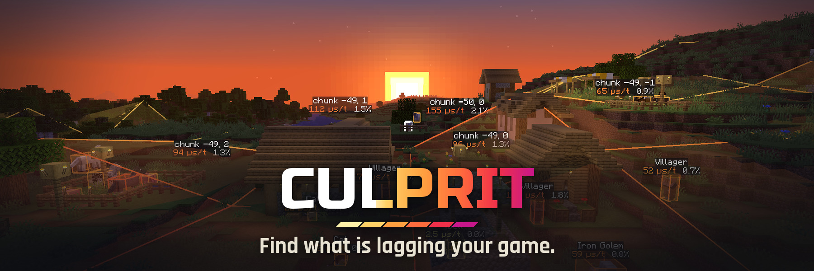
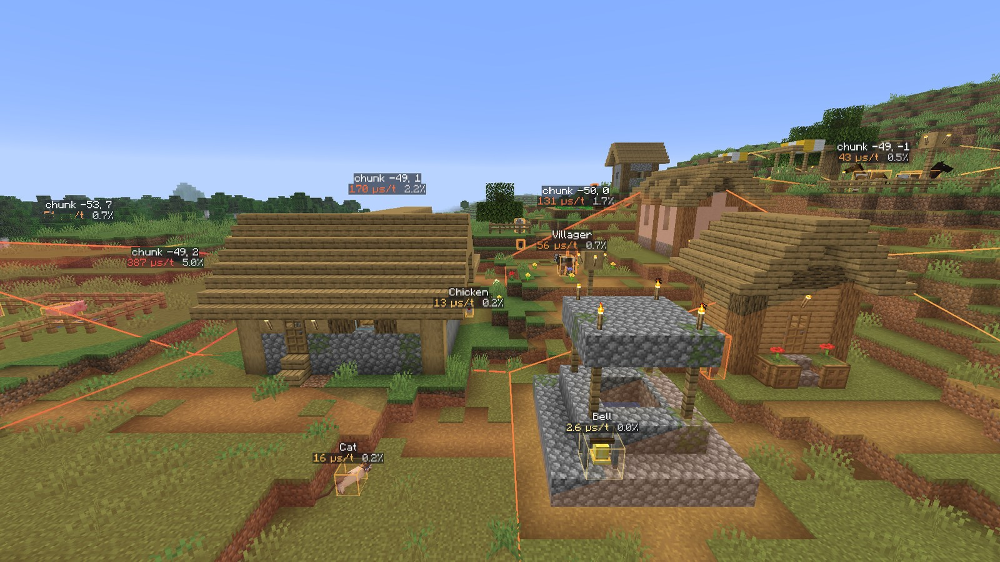
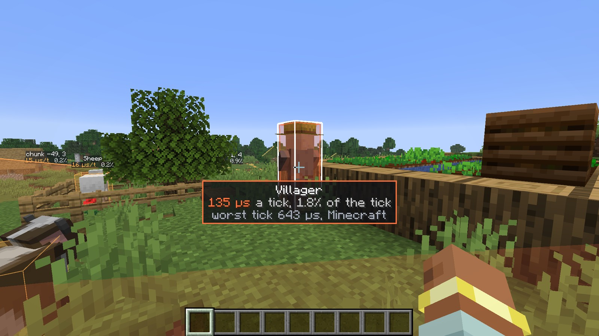
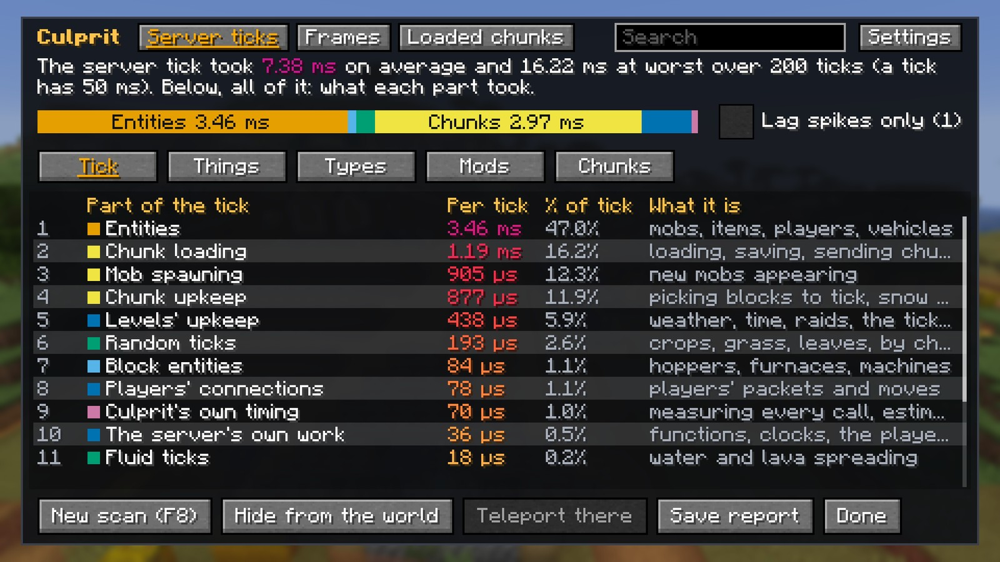
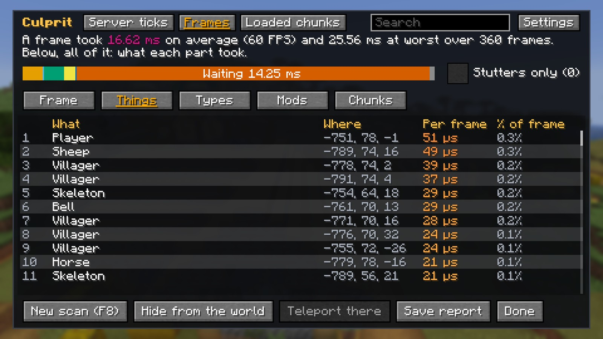
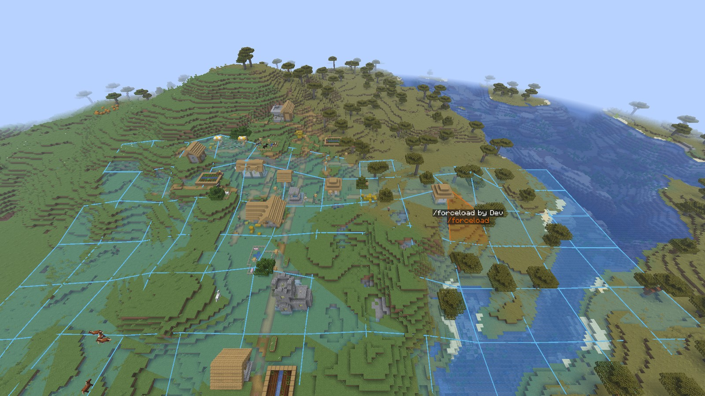

**Find what is lagging your game.**

Scan your server for a few seconds and see, on the world itself, what every villager, hopper, furnace and farm costs it
each tick, from pale yellow for the cheap to deep magenta for the worst. Do the same for your frame rate, and see what
keeps every chunk loaded and who asked for it. Culprit points at the thing to blame, where it stands, and names the mod
it comes from.

**NeoForge** for Minecraft **26.3**, **26.1.2** and **1.21.1** · **Forge** for **1.20.1** · singleplayer and servers ·
shader packs and Distant Horizons · no items, no blocks

## The cost of everything, on the world

Press **F8** and scan the server for 10, 30 or 60 seconds. When the scan ends, every mob and block entity that ticked is
boxed where it stands, coloured by what it cost on a scale that reads for colour-blind players too. The costliest close
ones carry a label, and each chunk's total sits on its outline. Nothing in your world is changed: Culprit only measures.

## Point at the culprit

Look at anything and Culprit reads it out under your crosshair: what it is, what it costs a tick, its share of the
tick, its worst tick and the mod it comes from.

## Every millisecond accounted for

Press **F9** for the results. The **Tick** tab lays out the whole server tick in parts (mobs, block entities, chunk
loading and upkeep, random ticks, mob spawning, block ticks, players' connections, the autosave, Culprit's own timing
and what was not measured), adding up to the tick. **Things**, **Types**, **Mods** and **Chunks** list the rest. Search
any list, click a line to mark it on the world with a beam, and teleport to it if you are an operator.

## Your frame rate, too

The frame scan does the same for your frames: what each mob, chest, sign and kind of particle costs to draw, and every
part of the frame, from building chunk meshes to waiting for the frame-rate limit. With a shader pack its shadows are a
part of their own, and so is Distant Horizons' far terrain. It runs on any server, even one without Culprit.

## What keeps the world loaded

The chunk inspector shows every loaded chunk and why: players, /forceload (and who ran it), portals, ender pearls, the
spawn, and other mods' chunk loaders, each named with the block, player or team behind it. See them on a map round you,
listed by what keeps them loaded, and outlined on the world.

## Lag spikes and stutters

Averages hide the ticks that stutter. Every scan also keeps its slowest ticks: tick **Lag spikes only** to see the
lists, the bar and the world over just those (the ticks over twice the usual one and at least 5 ms) and what ran in
them. Frames have **Stutters only**.

## Everything in it

- **Tick scan:** every block entity and entity tick, scheduled block and fluid ticks, block events, random ticks by kind
  of block, each chunk's upkeep and mob spawning, and the rest of the tick in parts.
- **Frame scan:** each entity and block entity drawn, particles by kind, every part of the frame, shader shadows and
  Distant Horizons' far terrain on their own.
- **Chunk inspector:** every loaded chunk of every dimension, why it is loaded, how busy it is and what is in it; on a
  map, listed by what keeps them loaded, and on the world.
- **On the world:** boxes coloured by cost, labels on the costliest close things, each chunk's total, the thing under
  your crosshair read out, and a beam over the thing you picked.
- **The results screen** (F9): Tick, Things, Types, Mods and Chunks for server ticks and for frames, a search box, a
  click to mark a thing, and teleport for operators.
- **Lag spikes and stutters** beside the averages, from the same scan.
- **Reports:** **Save report** writes the results as a page to share (Markdown) and as JSON in your game folder's
  `culprit/reports`; `/culprit export` does the same on a server.
- **A HUD line**, off until you turn it on: the server's ticks a second and time a tick (on a server, when you may scan
  there) and your frames a second, in the corner you choose.
- **Commands** for the console and the chat: `/culprit scan`, `stop`, `top`, `chunks` and `export`.
- **Light on your game:** while no scan runs, Culprit only checks a switch at each of the game's calls it watches.

More pictures in the **Images** tab.

## Getting started

1. Install NeoForge (Forge on Minecraft 1.20.1) and Culprit in your game. Add it to your server as well to scan the
   server's ticks and chunks there.
2. Press **F8** and pick how long to scan the server, or your frames, then play on.
3. When the chat says it is done, press **F9** for the results, then **Show on the world**.
4. Look at anything to read its cost, or click a line in the results to mark it on the world.

Both keys can be changed in **Controls**.

## For servers

- Operators may scan by default. The server's settings say who may (by permission level) and how long a scan may run
  (2 minutes by default).
- The results go to whoever started the scan.
- `/culprit scan [seconds]`, `/culprit stop`, `/culprit top [things|types|mods|chunks] [count]`, `/culprit chunks` and
  `/culprit export` work from the server's console as well as the chat.
- Measuring costs nothing until a scan runs; while one runs, Culprit times its own measuring and shows it as a part of
  the tick of its own.

## Works with

- **Shader packs:** Iris with Sodium on 26.3, 26.1.2 and 1.21.1, Oculus with Embeddium on 1.20.1. The results draw over
  the pack untouched, and the frame scan counts the pack's shadows on their own (tried with Complementary Reimagined on
  every version, and with Complementary Unbound, BSL, Bliss, Photon, Solas and MakeUp Ultra Fast on 26.3).
- **Sodium and Embeddium:** block entities and chunk meshes are measured with them as without.
- **Distant Horizons**, on every version: its far terrain is a part of the frame of its own.
- **Any mod's blocks and mobs**, measured as the game's own are and named by their mod; other mods' chunk loaders named
  with the block, player or team behind them.

## FAQ

- **Forge or Fabric?** NeoForge on Minecraft 26.3, 26.1.2 and 1.21.1; Forge on 1.20.1. No Fabric.
- **Which Java?** The one your launcher picks for your Minecraft version: 17 for 1.20.1, 21 for 1.21.1, 25 for 26.x.
- **Does the server need it?** For the tick scan and the chunk inspector, yes (in single player it always has it). The
  frame scan works on any server.
- **Does every player need it?** No. Players without it can join a server that has it, and use the commands if they
  may scan there.
- **Will it slow my game?** Not while it isn't scanning. While it scans, it times its own measuring and shows you what
  it took.
- **Is it like spark?** spark finds which code is slow; Culprit finds which thing in your world is, and where it is.
  They work well side by side.
- **Does it change my world?** No. It only measures.
- **Can I use it in a modpack?** Yes, freely.
- **Bedrock or Pocket Edition?** No, Java Edition only.

## Settings

Your own: how far things are boxed (16 to 128 blocks), how many are labelled (0 to 30), after how many minutes the
results hide themselves (or never), and the HUD line and its corner. The server's: who may scan, and the longest scan.

**How to change the settings**

**In game:** press **F9**, then **Settings** at the top right, or open **Mods**, choose **Culprit**, then **Config**.
- Minecraft 26.3, 26.1.2 and 1.21.1: **Config** in the mod list also shows the server's settings in a world of your
  own.
- Minecraft 1.20.1: the server's settings are in its file (below).

**In the file:** open it in any text editor; every setting has a note above it saying what it does.
- Every version: `config/culprit-client.toml` for your own settings.
- Minecraft 26.3: `config/culprit-synced.toml` for the server's, inside your Minecraft folder (on a server, inside the
  server's folder).
- Minecraft 26.1.2 and 1.21.1: `config/culprit-server.toml`, the same way.
- Minecraft 1.20.1: each world has its own, `serverconfig/culprit-server.toml` inside the world's folder (in `saves` in
  single player; on a server, inside its `world` folder).

## Requirements

Culprit comes in four files, one for each version of Minecraft; take the one for yours:

- **Minecraft 26.3**: NeoForge 26.3.0.103 or newer
- **Minecraft 26.1.2**: NeoForge 26.1.2.126 or newer
- **Minecraft 1.21.1**: NeoForge 21.1.266 or newer
- **Minecraft 1.20.1**: Forge 47.4 or newer

Nothing else is needed.

## Modpacks

You are free to include Culprit in any modpack. Its reports are made for sharing with a pack's makers.

## Planned

- Being considered: the time each mod's event handlers take, saved scans to compare before and after a change, and
  scans that start themselves when the server lags

## Links

- Source code: [GitHub](https://github.com/Lawman-afk/CulpritMCMod)
- Found a bug? Report it on the **Issues** tab.

## Credits

- Culprit is released under the [MIT licence](https://github.com/Lawman-afk/CulpritMCMod/blob/main/LICENSE).
